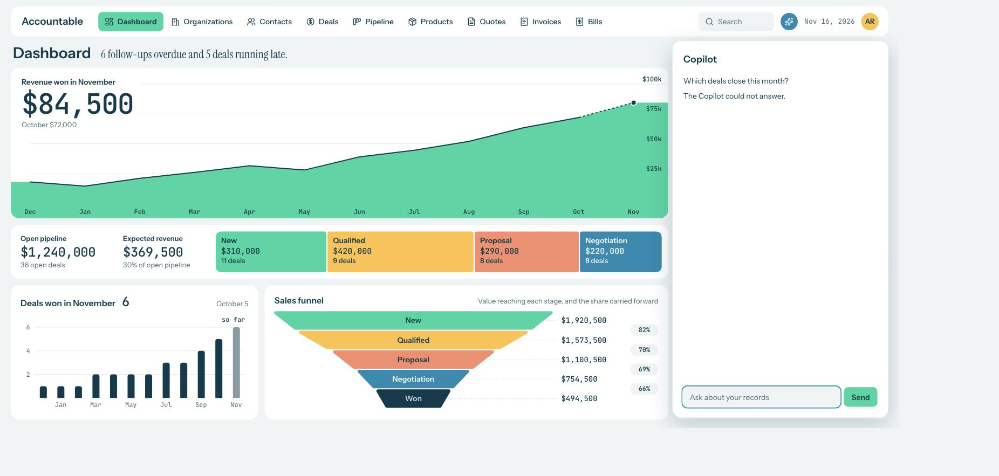
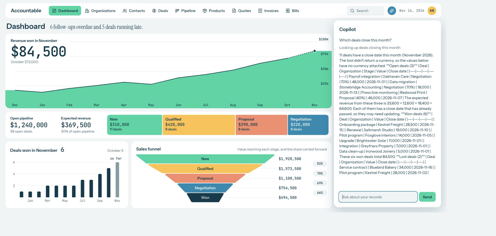

# Dashboard | Accountable

<!-- tabbridge guide, client: claude-code -->
Recorded by TabBridge on 2026-11-16 11:45, driven by claude-code. One step per screenshot, in order.

## Step 1: Dashboard | Accountable

- Pressed Escape
- Pressed Escape
- Clicked button "Menu for Alex Rivera"
- Clicked menuitemradio "Light"
- Resized the window to 1500×900
- Opened http://localhost:8000/
- Clicked button "Copilot"
- Clicked textbox "Ask about your records"
- Typed 2 characters
- Clicked button "Send"
- Opened http://localhost:8000/
- Clicked button "Copilot"
- Clicked textbox "Ask about your records"
- Typed 2 characters
- Clicked button "Send"

Page: Dashboard | Accountable — http://localhost:8000/

## Step 2: Dashboard | Accountable

- Opened http://localhost:8000/
- Clicked button "Copilot"
- Clicked textbox "Ask about your records"
- Typed 29 characters
- Clicked button "Send"

Page: Dashboard | Accountable — http://localhost:8000/

## Step 3: Dashboard | Accountable

- Opened http://localhost:8000/
- Clicked button "Copilot"
- Clicked textbox "Ask about your records"
- Typed 29 characters
- Clicked button "Send"

Page: Dashboard | Accountable — http://localhost:8000/

## Step 4: Dashboard | Accountable

- Opened http://localhost:8000/
- Clicked button "Copilot"
- Clicked textbox "Ask about your records"
- Typed 29 characters
- Clicked button "Send"

Page: Dashboard | Accountable — http://localhost:8000/

