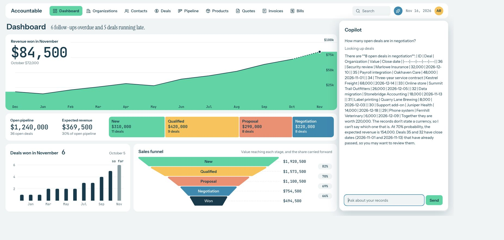
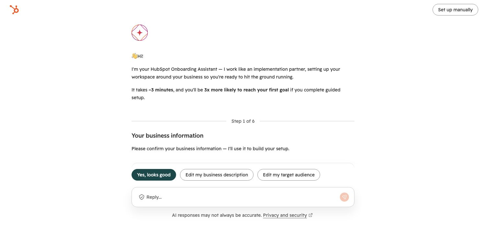
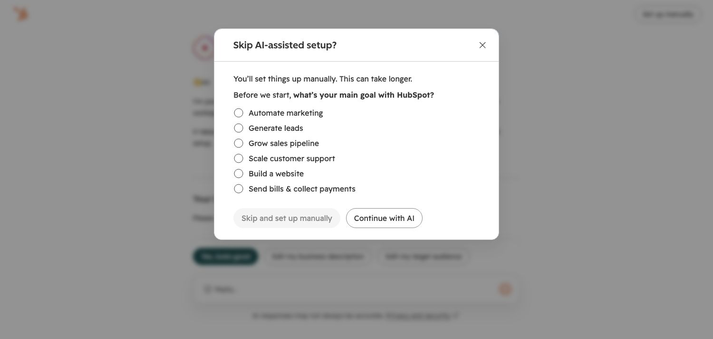
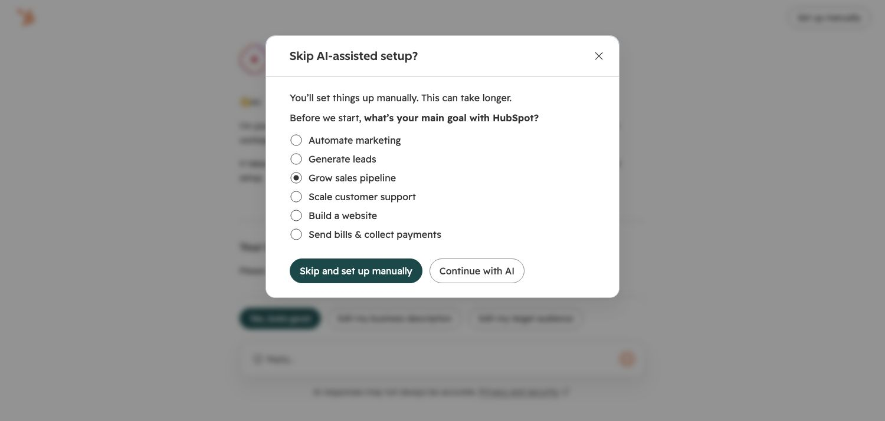
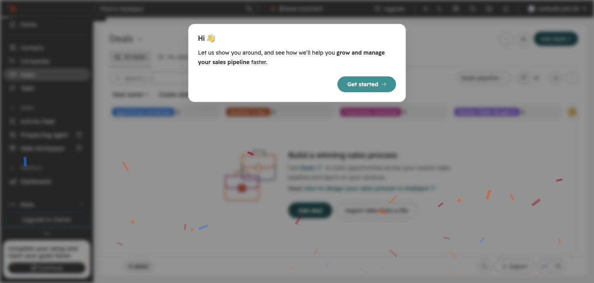
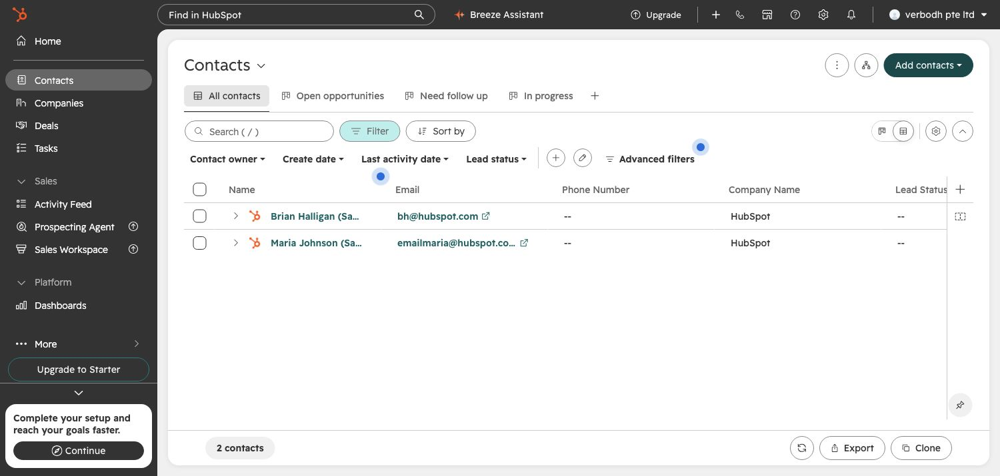
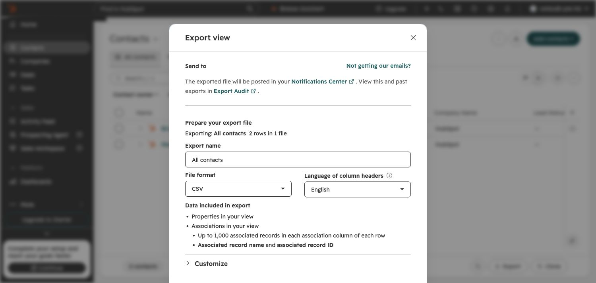
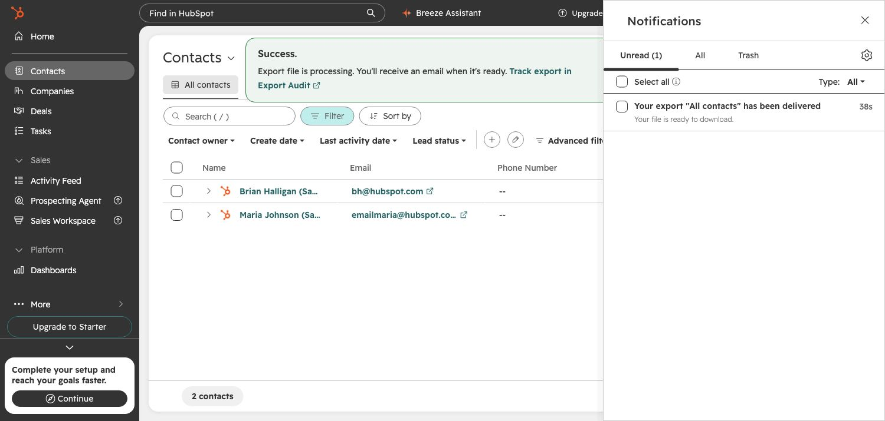

# Dashboard | Accountable

<!-- tabbridge guide, client: claude-code -->
Recorded by TabBridge on 2026-11-16 15:30, driven by claude-code. One step per screenshot, in order.

## Step 1: Dashboard | Accountable

- Opened http://localhost:8000/
- Clicked button "Copilot"
- Clicked textbox "Ask about your records"
- Typed 39 characters
- Clicked button "Send"

Page: Dashboard | Accountable — http://localhost:8000/

## Step 2: Set up CRM | HubSpot

- Opened https://app-na2.hubspot.com/set-up-crm/248020373/ai-assist?stepId=3&totalSteps=7&progress=true&step=review&lang=en&via=crm-signup in a new tab

Page: Set up CRM | HubSpot — https://app-na2.hubspot.com/set-up-crm/248020373/ai-assist?stepId=3&totalSteps=7&progress=true&step=review&lang=en&via=crm-signup

## Step 3: Set up CRM | HubSpot

- Clicked button "Set up manually"

Page: Set up CRM | HubSpot — https://app-na2.hubspot.com/set-up-crm/248020373/ai-assist?stepId=3&totalSteps=7&progress=true&step=review&lang=en&via=crm-signup

## Step 4: Set up CRM | HubSpot

- Clicked radio "Grow sales pipeline"
- Clicked button "Skip and set up manually"

Page: Set up CRM | HubSpot — https://app-na2.hubspot.com/set-up-crm/248020373/ai-assist?stepId=3&totalSteps=7&progress=true&step=review&lang=en&via=crm-signup

## Step 5: Set up CRM | HubSpot

- Clicked label "Grow sales pipeline"

Page: Set up CRM | HubSpot — https://app-na2.hubspot.com/set-up-crm/248020373/ai-assist?stepId=3&totalSteps=7&progress=true&step=review&lang=en&via=crm-signup

## Step 6: Deals | All deals

- Clicked button "Skip and set up manually"

Page: Deals | All deals — https://app-na2.hubspot.com/contacts/248020373/objects/0-3/views/all/board?tourId=post-setup-deals-pipeline-in-app-side-panel-with-welcome&via=setup-progress

## Step 7: Contacts | All contacts

- Opened https://app-na2.hubspot.com/contacts/248020373/objects/0-1/views/all/list

Page: Contacts | All contacts — https://app-na2.hubspot.com/contacts/248020373/objects/0-1/views/all/list

## Step 8: Contacts | All contacts

- Clicked button "Export"

Page: Contacts | All contacts — https://app-na2.hubspot.com/contacts/248020373/objects/0-1/views/all/list

## Step 9: Contacts | All contacts

- Clicked button "Export"
- Clicked button "Notifications: 1 unseen"

Page: Contacts | All contacts — https://app-na2.hubspot.com/contacts/248020373/objects/0-1/views/all/list

