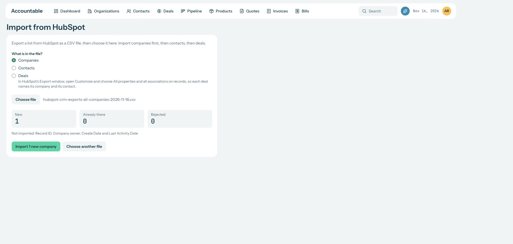
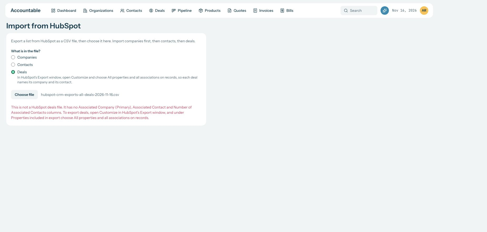
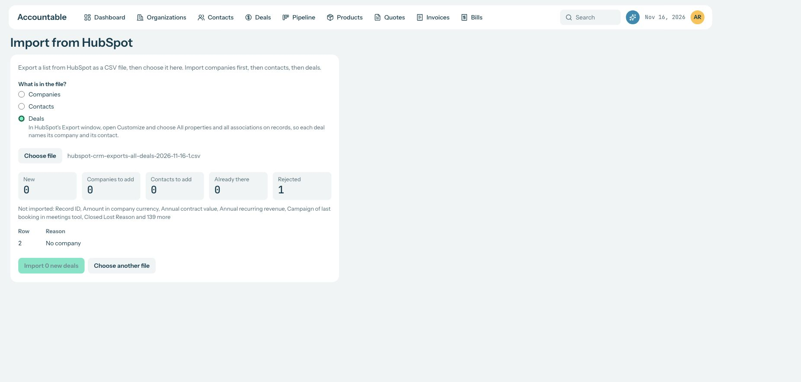
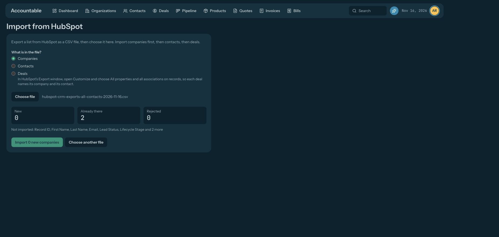
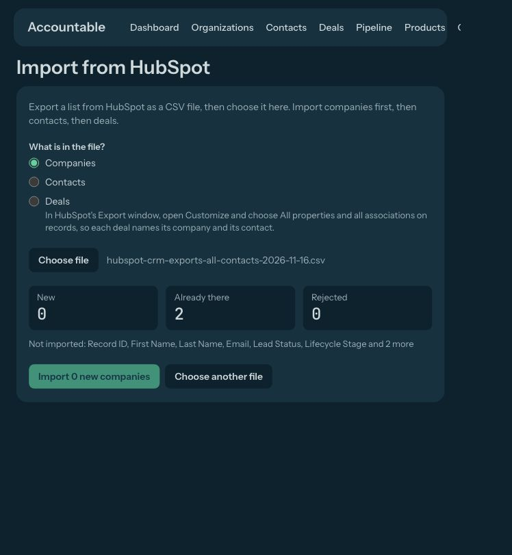

# Import from HubSpot | Accountable

<!-- tabbridge guide, client: claude-code -->
Recorded by TabBridge on 2026-11-16 17:06, driven by claude-code. One step per screenshot, in order.

## Step 1: Import from HubSpot | Accountable

- Clicked iframe "nav-components:notifications-sidebar"
- Opened https://app-na2.hubspot.com/contacts/248020373/objects/0-2/views/all/list
- Clicked button "Export"
- Clicked button "Export"
- Clicked button "Notifications: 1 unseen"
- Clicked iframe "nav-components:notifications-sidebar"
- Opened https://app-na2.hubspot.com/contacts/248020373/objects/0-3/views/all/list
- Clicked button "Export"
- Clicked button "Export"
- Clicked button "Notifications: 1 unseen"
- Clicked iframe "nav-components:notifications-sidebar"
- Opened https://app-na2.hubspot.com/contacts/248020373/objects/0-3/views/all/list
- Clicked button "Export"
- Clicked button "Customize"
- Clicked radio "Properties included in export All properties and all associations on records"
- Clicked button "Export"
- Clicked button "Notifications: 1 unseen"
- Clicked iframe "nav-components:notifications-sidebar"
- Opened http://localhost:5273/ in a new tab
- Clicked button "AR Alex Rivera alex.rivera@accountable.example"
- Opened http://localhost:5273/import
- Attached hubspot-crm-exports-all-companies-2026-11-16.csv

Page: Import from HubSpot | Accountable — http://localhost:5273/import

## Step 2: Import from HubSpot | Accountable

- Clicked button "Import 1 new company"
- Clicked button "Import another file"
- Clicked radio "Contacts"
- Attached hubspot-crm-exports-all-contacts-2026-11-16.csv

Page: Import from HubSpot | Accountable — http://localhost:5273/import

## Step 3: Import from HubSpot | Accountable

- Clicked button "Import 2 new contacts"
- Clicked button "Import another file"
- Clicked radio "Deals"
- Attached hubspot-crm-exports-all-deals-2026-11-16.csv

Page: Import from HubSpot | Accountable — http://localhost:5273/import

## Step 4: Import from HubSpot | Accountable

- Attached hubspot-crm-exports-all-deals-2026-11-16-1.csv

Page: Import from HubSpot | Accountable — http://localhost:5273/import

## Step 5: Import from HubSpot | Accountable

- Opened http://localhost:5273/contacts
- Opened http://localhost:5273/organizations
- Opened http://localhost:5273/import
- Attached hubspot-crm-exports-all-contacts-2026-11-16.csv
- Clicked button "Menu for Alex Rivera"
- Clicked menuitemradio "Dark"

Page: Import from HubSpot | Accountable — http://localhost:5273/import

## Step 6: Import from HubSpot | Accountable

- Resized the window to 500×800

Page: Import from HubSpot | Accountable — http://localhost:5273/import

